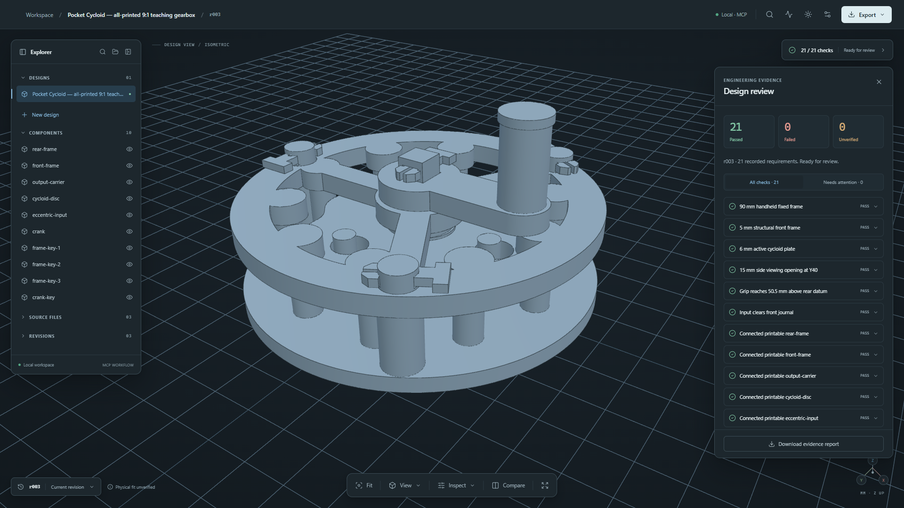

<div align="center">

# CAD-Harness

**Editable CAD. Measured evidence. One design loop.**

Source-driven parametric modeling and geometry verification for your IDE assistant.

[](pyproject.toml) [](https://github.com/gumyr/build123d)

[Get started](#quick-start) · [Studio](docs/STUDIO.md) · [Author a project](docs/GETTING_STARTED.md) · [Documentation](docs/README.md)

</div>

[](docs/assets/studio-hero.png)

<p align="center"><sub>Real geometry in Studio. The <a href="models/pocket-cycloid/README.md">Pocket Cycloid</a> teaching gearbox, built from editable Python and inspected against recorded requirements.</sub></p>

## From intent to geometry

CAD-Harness connects parametric Python, OCCT geometry, and a local 3D workbench.
Your IDE assistant authors and revises the design through MCP; Studio shows the
built parts, measurements, source, and revision history. MCP mode uses your host
assistant and makes no separate model calls.

| Author | Inspect | Verify |
| :--- | :--- | :--- |
| Editable build123d source with stable component IDs. | Interactive 3D geometry, component isolation, and revision comparison. | Geometry-derived measurements, requirement checks, and retained evidence. |

A `cadharness.toml` manifest points to a trusted Python factory returning a
`CADDocument`. Source remains the design authority. Failed checks return to the
assistant for repair; STEP and STL exports are explicit. The Python framework
and CLI also work independently of Studio.

## Quick start

Requires **Python 3.11–3.14**. Studio setup also needs **Node.js 22.12+** and npm.
From Windows PowerShell:

```powershell
git clone https://github.com/jasonshaw0/CAD-Harness.git
cd CAD-Harness
python bootstrap.py
```

Or on Linux/macOS, use the same clone and `cd` commands, then run
`python3 bootstrap.py`. After setup, replace `.\.venv\Scripts\python.exe`
with `./.venv/bin/python` in the examples below; activation is optional.

Setup creates `.venv`, installs dependencies, builds Studio, verifies an example,
and writes `.cadharness/mcp.json`. Add its `cadharness` entry to your MCP host and
reload the host. Call `studio_status` for the viewer URL, normally
`http://127.0.0.1:8741`. See [Studio setup](docs/STUDIO.md) for configuration.

For framework-only setup, use `python bootstrap.py --framework-only` without
Node.js (Linux/macOS: `python3 bootstrap.py --framework-only`).

## Try the evidence loop

```powershell
.\.venv\Scripts\python.exe -m cadharness verify examples/nema17-mount --summary
.\.venv\Scripts\python.exe -m cadharness inspector examples/nema17-mount --summary
```

Add `--variant missing-hole` to the verification command to see a failed check.
The inspector writes a linked HTML report. Commands return JSON by default;
`--summary` selects readable output. Exit codes: **0** pass, **1** failed gate,
**2** usage or execution error.

After activating `.venv`, `cad-harness` and `cad-harness-mcp` are the short
entrypoints. Python imports, manifests, MCP configuration keys, and the legacy
`cadharness` commands retain their compatible names.

## Explore

| Guide | What you will find |
| :--- | :--- |
| [Project authoring](docs/GETTING_STARTED.md) | Manifests, factories, components, and checks. |
| [Studio](docs/STUDIO.md) | MCP setup, viewport controls, and local workspaces. |
| [CLI & MCP](docs/CLI_MCP.md) | Commands, evidence, and framework-only integration. |
| [Architecture](docs/ARCHITECTURE.md) | Framework, orchestration, and Studio internals. |

[All documentation](docs/README.md) · [Contributing](CONTRIBUTING.md) ·
[Design workflow](docs/DESIGN_WORKFLOW.md) · [Migration](docs/MIGRATION.md) ·
[Changelog](CHANGELOG.md)

---

**Experimental.** Interfaces and workflows may change. Project factories execute
trusted local Python without sandboxing; keep MCP roots explicit and limited to
trusted projects. Passing checks provides computational evidence for encoded
requirements. Physical fit and manufacturing performance need separate validation.
