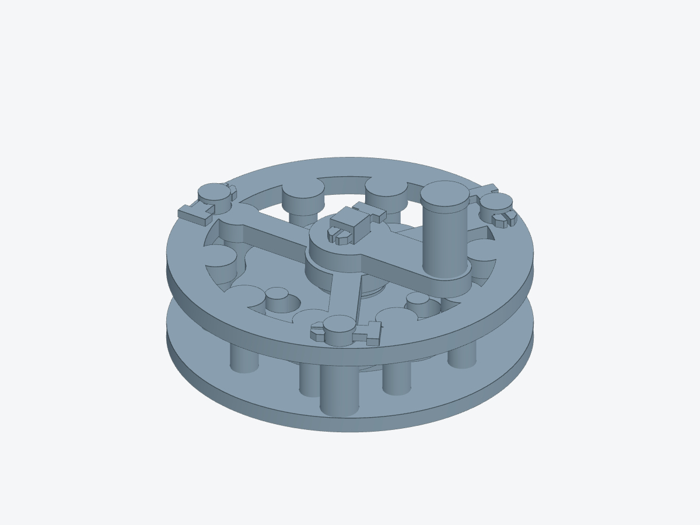

# Pocket Cycloid

An editable, all-printed **9:1 cycloidal teaching gearbox**. Ten fixed pins
engage a nine-lobed disc; three output pins remove its orbital motion.

- 90 mm body; 58.5 mm overall axial envelope including grip and rear output.
- Ten printed parts: six main parts and four identical split cotters.
- Integral plain journals, a 28 mm crank radius, and an accessible upright grip.
- Open front and 15 mm side viewing gaps; continuous rim and three structural ribs.

[Print and assembly guide](docs/BUILD.md) · [Editable model](project.py) ·
[Verification evidence](evidence/verification.json) · [Top view](previews/mcp-top.png)

Geometry and kinematics pass computational checks. **Physical print fit, dry
friction, and cotter endurance remain untested.**
